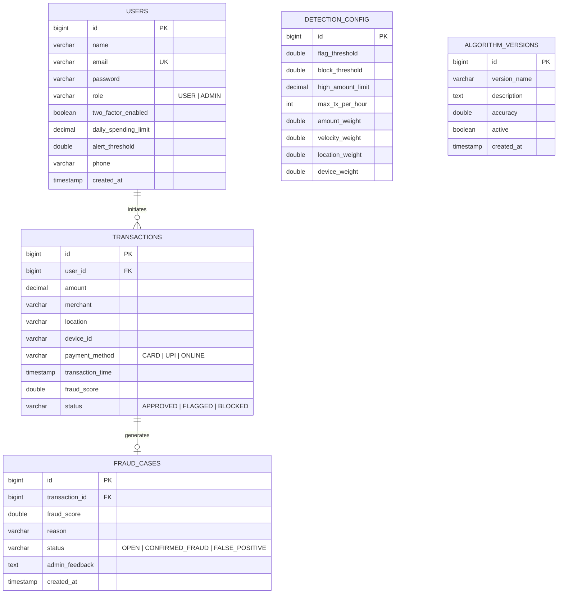
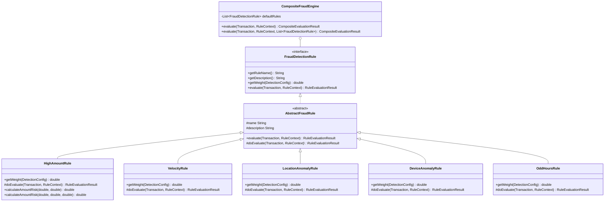
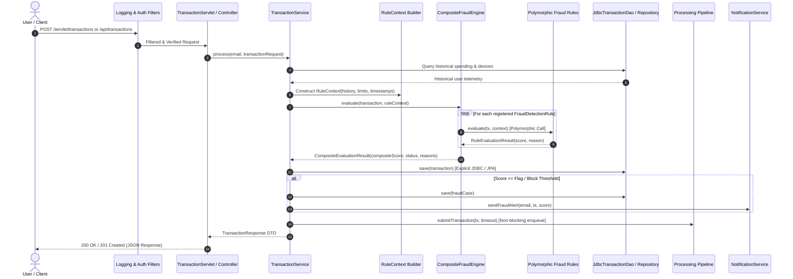

# FraudShield: System Architecture & Technical Design Document

This document outlines the architectural blueprints, database domain modeling, object-oriented design patterns, concurrency pipelines, and algorithmic scoring heuristics implemented in the **FraudShield AI-Powered Fraud Detection System**.

---

## 1. System Architecture Overview

FraudShield employs a **layered, decoupled enterprise architecture** supporting both modern RESTful API integrations and administrative server-rendered dashboards (Thymeleaf). It provides dual data-access mechanics (Spring Data JPA alongside raw JDBC DAOs) and an asynchronous multithreaded processing pipeline.

```mermaid
graph TD
    subgraph Client Tier
        Browser[Web Browser / Thymeleaf Admin & User UI]
        APIClient[External API Client / Payment Gateway]
    end

    subgraph Security & Filter Tier
        EncodingFilter[CharacterEncodingFilter (UTF-8)]
        LoggingFilter[RequestLoggingFilter (Audit & Timing)]
        AuthFilter[AuthenticationFilter]
        AuthzFilter[AuthorizationFilter (Role-Based)]
        SecurityChain[Spring Security Dual Filter Chains]
    end

    subgraph Presentation Tier
        ThymeleafControllers[Spring MVC Controllers\n(/admin/**, /user/**)]
        RestControllers[REST API Controllers\n(/api/** - JWT)]
        JakartaServlets[Jakarta HttpServlets\n(/servlet/**)]
    end

    subgraph Service & Concurrency Tier
        TxService[TransactionService]
        CaseService[FraudCaseService]
        ConfigService[ConfigService]
        AlgoService[AlgorithmService]
        ReportService[ReportService]
        NotifyService[NotificationService]
        Pipeline[TransactionProcessingPipeline\n(ArrayBlockingQueue + ReentrantLock)]
        ScanService[FraudScanService\n(FixedThreadPool ExecutorService)]
        Scheduler[StatisticsRefreshTask\n(ScheduledExecutorService)]
        Metrics[FraudMetricsCounter\n(AtomicLong, AtomicInteger)]
        Cache[ThreadSafeCache\n(ConcurrentHashMap)]
    end

    subgraph Fraud Rule Engine Tier
        Engine[CompositeFraudEngine]
        Context[RuleContext (Telemetry)]
        Rule1[HighAmountRule]
        Rule2[VelocityRule]
        Rule3[LocationAnomalyRule]
        Rule4[DeviceAnomalyRule]
        Rule5[OddHoursRule]
    end

    subgraph Data Access Layer
        JPA[Spring Data JPA Repositories]
        JDBC[Explicit JDBC DAO Layer\n(JdbcTransactionDao, JdbcUserDao, JdbcFraudCaseDao)]
        DS[DataSourceProvider (HikariCP Connection Pool)]
    end

    subgraph Storage Tier
        DB[(H2 Database / MySQL 8.x Engine)]
    end

    Browser --> EncodingFilter
    APIClient --> EncodingFilter
    EncodingFilter --> LoggingFilter --> AuthFilter --> AuthzFilter --> SecurityChain

    SecurityChain --> ThymeleafControllers
    SecurityChain --> RestControllers
    SecurityChain --> JakartaServlets

    ThymeleafControllers --> TxService
    ThymeleafControllers --> CaseService
    RestControllers --> TxService
    JakartaServlets --> TxService
    JakartaServlets --> CaseService
    JakartaServlets --> ConfigService
    JakartaServlets --> ReportService

    TxService --> Engine
    TxService --> Pipeline
    TxService --> NotifyService
    Pipeline --> ScanService
    ScanService --> Engine

    Engine --> Rule1
    Engine --> Rule2
    Engine --> Rule3
    Engine --> Rule4
    Engine --> Rule5
    Engine --> Context

    TxService --> JPA
    TxService --> JDBC
    CaseService --> JPA
    CaseService --> JDBC
    Scheduler --> ReportService
    ReportService --> Cache
    ScanService --> Metrics

    JPA --> DB
    JDBC --> DS --> DB
```

---

## 2. Entity-Relationship (ER) Domain Model

The schema captures users, transactions, automated/manual fraud cases, dynamic threshold configurations, and machine learning algorithm versions.



---

## 3. Object-Oriented Class Hierarchy & Polymorphism

The fraud rule evaluation system uses the **Composite Pattern** and strict **Runtime Polymorphism**:



---

## 4. End-to-End Transaction Request Processing Sequence



---

## 5. Algorithmic Breakdown: Weighted Anomaly Scoring & Adaptive Feedback Loop

### 5.1 Weighted Anomaly Scoring Heuristic

For any incoming transaction $T$, the normalized risk score $S(T) \in [0.0, 1.0]$ is computed as:

$$S(T) = \frac{\sum_{i=1}^{N} w_i \cdot r_i(T)}{\sum_{i=1}^{N} w_i}$$

Where:
- $w_i$ represents the dynamic weight assigned to rule $i$ (configured in `DetectionConfig`).
- $r_i(T) \in [0.0, 1.0]$ represents the continuous risk evaluation produced by rule $i$.

The system makes deterministic triage decisions based on configured thresholds:
- **APPROVED:** $S(T) < \theta_{\text{flag}}$ (typically $< 0.40$)
- **FLAGGED:** $\theta_{\text{flag}} \le S(T) < \theta_{\text{block}}$ (typically $[0.40, 0.70)$) $\rightarrow$ An investigation case (`OPEN`) is raised.
- **BLOCKED:** $S(T) \ge \theta_{\text{block}}$ (typically $\ge 0.70$) $\rightarrow$ Immediate transaction rejection and cardholder notification.

### 5.2 Adaptive Feedback-Loop Retraining (`AlgorithmService`)

When human risk analysts or cardholders resolve fraud cases (marking them `CONFIRMED_FRAUD` or `FALSE_POSITIVE`), the feedback loop computes empirical precision:

$$P = \frac{\text{Confirmed Fraud}}{\text{Confirmed Fraud} + \text{False Positives}}$$

1. **High False Positive Rate ($P < 0.50$):**
   The engine automatically increments the flag threshold $\theta_{\text{flag}} \leftarrow \min(\theta_{\text{flag}} + 0.05, \theta_{\text{block}} - 0.05)$, reducing analyst fatigue and user friction.
2. **High Precision ($P > 0.80$):**
   The engine safely lowers the sensitivity threshold $\theta_{\text{flag}} \leftarrow \max(\theta_{\text{flag}} - 0.02, 0.20)$, capturing emerging fraudulent signals earlier.
3. A new immutable version is registered in `algorithm_versions` tracking accuracy, description, and timestamp.
